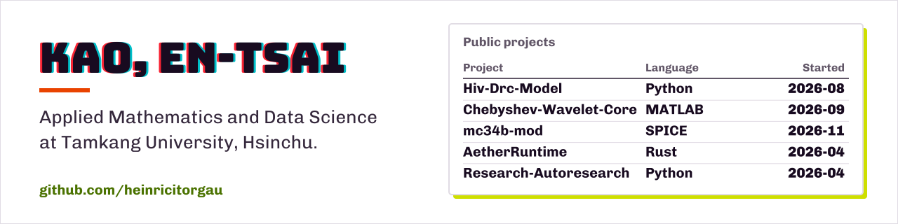
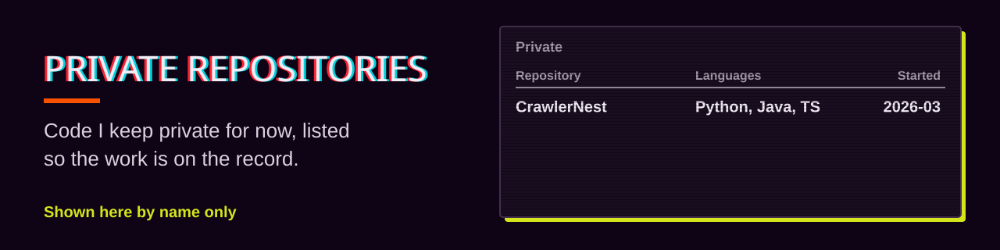

  

I study Applied Mathematics & Data Science at Tamkang University. I like problems where a model has to hold up against real data: numerical solvers, epidemic models, data pipelines, and circuits that exist only in simulation.

我在淡江大學念應用數學與資料科學，喜歡做模型必須經得起真實資料檢驗的題目，像是數值解法、傳染病模型、資料管線，還有只存在於模擬中的電路。

### Projects

<table>
  <tr>
    <td width="50%" valign="top">
      
       <b><a href="https://github.com/heinricitorgau/Hiv-Drc-Model">Hiv-Drc-Model</a></b> (Python) 
      A tested reproduction of a six-compartment HIV/AIDS treatment model for the DRC. It adds sensitivity analysis and recovers hidden rates from data with least squares and Bayesian MCMC.
    </td>
    <td width="50%" valign="top">
      
       <b><a href="https://github.com/heinricitorgau/Chebyshev-Wavelet-Core">Chebyshev-Wavelet-Core</a></b> (MATLAB) 
      Operational matrices (OMI / POM) for second-kind Chebyshev wavelets at arbitrary resolution, with optional GPU acceleration, for differential equations and time-series features.
    </td>
  </tr>
  <tr>
    <td width="50%" valign="top">
      
       <b><a href="https://github.com/heinricitorgau/mc34b-mod">mc34b-mod</a></b> (SPICE) 
      A simulation-only design of a 6P3S-E push-pull ultralinear stereo tube amplifier in LTspice / ngspice, from fitted tube models to loop stability.
    </td>
    <td width="50%" valign="top">
      
       <b><a href="https://github.com/heinricitorgau/AetherRuntime">AetherRuntime</a></b> (Rust / Python) 
      Offline benchmarking and LoRA training infrastructure for evaluating local coding models.
    </td>
  </tr>
  <tr>
    <td width="50%" valign="top">
      
       <b><a href="https://github.com/heinricitorgau/Research-Autoresearch">Research-Autoresearch</a></b> (Python) 
      A learning edition of an autonomous LLM research loop, adapted to run on Apple Silicon and consumer NVIDIA GPUs.
    </td>
    <td width="50%" valign="top">
      
       <b>Private repositories</b> (not public yet) 
      CrawlerNest, a multi-source university ranking platform: crawlers ingest QS, THE and ARWU into a PostgreSQL warehouse, entity resolution merges them, and a Spring Boot API and Next.js site serve the results with explicit caveats.
    </td>
  </tr>
</table>

### Tools

