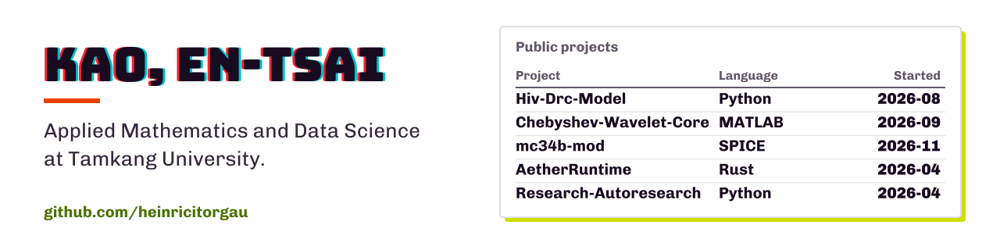
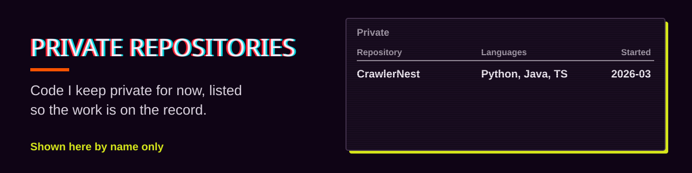

  <picture><source media="(prefers-color-scheme: dark)" srcset="https://raw.githubusercontent.com/heinricitorgau/heinricitorgau/main/assets/banner-dark.svg"></picture>

I build models and then test them against real data: numerical solvers, epidemic models, data pipelines, and circuits designed in simulation.

我喜歡先建立模型，再用真實資料驗證它，做過的題目包括數值解法、傳染病模型、資料管線，以及在模擬軟體裡設計的電路。

### Highlights

| | Result · 成果 | |
| --- | --- | --- |
| [**Hiv-Drc-Model**](https://github.com/heinricitorgau/Hiv-Drc-Model) | Reproduces a published HIV/AIDS model to six digits, runs it backwards to recover hidden rates from noisy data, then shows it cannot be calibrated to real UNAIDS data. 重現已發表的 HIV/AIDS 模型到小數點後六位，反推隱藏參數，並證明它無法以 UNAIDS 真實資料校準。 |    |
| [**Chebyshev-Wavelet-Core**](https://github.com/heinricitorgau/Chebyshev-Wavelet-Core) | Chebyshev-wavelet operational matrices for any resolution and order: matches the paper with zero error, converges at the theoretical rate, and is cross-checked against Lean 4 proofs. 任意解析度與階數的 Chebyshev 小波運算矩陣：與論文逐項誤差為零、以理論速率收斂，並與 Lean 4 證明交叉比對。 |   |

### Projects

<a href="https://github.com/heinricitorgau/Hiv-Drc-Model"><picture><source media="(prefers-color-scheme: dark)" srcset="https://raw.githubusercontent.com/heinricitorgau/Hiv-Drc-Model/main/assets/banner-dark.svg"></picture></a>
<a href="https://github.com/heinricitorgau/Chebyshev-Wavelet-Core"><picture><source media="(prefers-color-scheme: dark)" srcset="https://raw.githubusercontent.com/heinricitorgau/Chebyshev-Wavelet-Core/main/assets/banner-dark.svg"></picture></a>
<a href="https://github.com/heinricitorgau/mc34b-mod"><picture><source media="(prefers-color-scheme: dark)" srcset="https://raw.githubusercontent.com/heinricitorgau/mc34b-mod/main/assets/banner-dark.svg"></picture></a>
<a href="https://github.com/heinricitorgau/AetherRuntime"><picture><source media="(prefers-color-scheme: dark)" srcset="https://raw.githubusercontent.com/heinricitorgau/AetherRuntime/main/assets/aether-banner-dark.svg"></picture></a>
<a href="https://github.com/heinricitorgau/Research-Autoresearch"><picture><source media="(prefers-color-scheme: dark)" srcset="https://raw.githubusercontent.com/heinricitorgau/Research-Autoresearch/main/assets/banner-dark.svg"></picture></a>
<picture><source media="(prefers-color-scheme: dark)" srcset="https://raw.githubusercontent.com/heinricitorgau/heinricitorgau/main/assets/private-dark.svg"></picture>

### Tools

